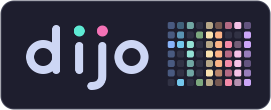

<p align="center">
  
</p>

# dijo

`dijo` is a habit tracker that runs in your terminal. It is modal and keyboard-driven, much like a certain text editor: you move with `hjkl`, change the view with `v`, and type commands after `:`.

This repository is the [1995parham](https://github.com/1995parham/dijo) fork of [nerdypepper/dijo](https://github.com/nerdypepper/dijo). It adds weekly goals, habit descriptions, the sparkline, stats and heatmap views, a dashboard for each habit, and monthly archives.

## Features

- **A card for each habit**: each habit has its own color, and the top border shows the progress of today. The grid uses as many columns as the terminal has room for, up to three.
- **Vim-like motions**: move between habits with `hjkl` and move the day cursor with `HJKL`.
- **Seven views**: cycle every habit through `DAY`, `WEEK`, `MONTH`, `SPARKLINE`, `YEAR`, `STATS` and `HEATMAP` with `v`.
- **Daily and weekly goals**: track a yes/no habit, a count, or a decimal amount, each day or each Monday-to-Sunday week.
- **Contribution heatmap**: a GitHub-style grid of your history, which includes the archived months.
- **Dashboard**: press `d` for the all-time stats and a year-long heatmap of the focused habit.
- **Vim-like command mode**: add a habit with `:add`, delete one with `:delete`, and quit with `:q`. `Tab` completes command names and habit names.
- **Themes**: set the characters, the colors and the list of habit colors in `config.toml`.

## Install

### Prebuilt binaries

Download the archive for your platform from the [Releases](https://github.com/1995parham/dijo/releases) page. Each archive contains the `dijo` binary, this README and the man page `dijo.1`. The releases cover Linux (x86_64), macOS (x86_64 and aarch64) and Windows (x86_64).

### Cargo

`dijo` uses the Rust 2024 edition, so you need a recent stable toolchain.

```shell
rustup update
cargo install --git https://github.com/1995parham/dijo
```

`cargo install dijo` installs the upstream crate from crates.io, which does not have the features of this fork.

## Usage

Run `dijo` to open the grid of habits. `dijo` writes the habits to disk when you quit. The man page ([`dijo.1`](./dijo.1)) has the full reference.

```shell
dijo                  # open the habit grid
dijo --list           # print the names of the habits
dijo --missing gym    # print the days of this month that have no entry for `gym`
dijo track water      # add 1 to today's `water`; `dijo track run 2.5`, `dijo track water -1`
dijo track read --date 2026-11-26   # mark a yes/no habit as done on another day
dijo status           # print today's progress, such as `3/5 done today`
dijo status --json    # the same for scripts, with `text`, `tooltip` and `class` for waybar
```

`dijo track` sets a yes/no habit to yes, and a second run keeps it at yes; `-1` sets it to no. `dijo track smoke 0` records a clean day of a limit habit. Do not run `dijo track` while the grid is open, because the grid writes its own state when you quit.

### Habits and goals

Add a habit in command mode with `:add <name> [goal]`. The goal sets the type of the habit.

| Command | Habit |
| --- | --- |
| `:add read 1` | a yes/no habit for each day |
| `:add water 8` | a count with a goal of 8 each day |
| `:add run 2.5` | a decimal amount with a goal of 2.5 each day |
| `:add gym 3/week` | a count with a goal of 3 each week (also `/w` and `/weekly`) |
| `:add smoke <5` | a limit: a day is reached when it has at most 5 |
| `:add coffee` | a count with no goal, only to record a number |

A weekly goal counts all the entries from Monday to Sunday. The streaks and the completion rate of a weekly habit count weeks, not days.

A limit is per day. A day counts only when it has an entry, so press `p` on an empty day to record a clean day (0). A day over the limit shows in the undone color, and the card shows `over`.

`:describe <name> <text...>` adds a description to a habit. The grid shows the first line of the description, and `i` shows the full text. Write `\n` in the text to start a new line.

### Views

Press `v` to cycle the view for every habit. `Esc` goes back to `DAY` and resets the cursor.

| View | Shows |
| --- | --- |
| `DAY` | the month as a calendar, with the value of each day |
| `WEEK` | a completion bar for each week of the month |
| `MONTH` | the completion of each month of the year |
| `SPARKLINE` | the month in one row, with a bar for each day whose height follows the completion of that day |
| `YEAR` | a completion bar for each year |
| `STATS` | the current streak, the longest streak, the total completions and the completion rate |
| `HEATMAP` | a contribution grid of the trailing weeks (`[` and `]` scroll it) |

### Keybindings

| Key | Action |
| --- | --- |
| `h` `j` `k` `l` or the arrow keys | move the focus between habits |
| `Tab` / `Shift-Tab` | move the focus to the next / previous habit |
| `H` `J` `K` `L` or `Shift` with an arrow key | move the day cursor |
| `n` / `Enter` / `Ctrl-a` | add one to the day under the cursor |
| `p` / `Backspace` / `Ctrl-x` | subtract one from the day under the cursor |
| `v` | cycle the view |
| `d` | open the dashboard of the focused habit (`q` or `Esc` closes it) |
| `i` | show the full description of the focused habit (`q` or `Esc` closes it) |
| `<` `>` | move the focused habit one place left / right in the grid |
| `[` `]` | go to the previous / next month |
| `}` | move the cursor back to today |
| `Esc` | go back to the `DAY` view and reset the cursor |
| `Ctrl-l` | clear the message line |
| `:` | open command mode |

### Commands

| Command | Alias | Action |
| --- | --- | --- |
| `:add <name> [goal]` | `:a` | add a habit |
| `:describe <name> <text...>` | `:desc` | set the description of a habit |
| `:delete <name>` | `:d` | delete a habit |
| `:rename <name> <new-name>` | | rename a habit and its archived months |
| `:goal <name> <goal>` | | change the goal, in the same kind of habit (`:goal gym 4/week`) |
| `:month-prev` | `:mprev` | go to the previous month |
| `:month-next` | `:mnext` | go to the next month |
| `:archive` | | move the entries of past months to the archive |
| `:dashboard` | `:dash` | open the dashboard of the focused habit |
| `:write` | `:w` | write the habits to disk |
| `:quit` | `:q` | write the habits to disk and quit |
| `:writeandquit` | `:wq` | write the habits to disk and quit |
| `:help [<command>\|commands\|keys]` | `:h`, `:?` | show help in the message line |

## Files

`dijo` keeps the habits in `habit_record.json` in the data directory and the settings in `config.toml` in the configuration directory. `:archive` writes the entries of each past month to `archive/{month}_{year}.json` in the data directory. The stats and the heatmap continue to count the archived days.

| Platform | Configuration directory | Data directory |
| --- | --- | --- |
| Linux | `~/.config/dijo` | `~/.local/share/dijo` |
| macOS | `~/Library/Application Support/rs.nerdypepper.dijo` | `~/Library/Application Support/rs.nerdypepper.dijo` |
| Windows | `%APPDATA%\nerdypepper\dijo\config` | `%APPDATA%\nerdypepper\dijo\data` |

### Configuration

`dijo` writes a default `config.toml` on the first run. If the file is missing or invalid, `dijo` uses the defaults.

```toml
[look]
true_chr = "●"      # a yes/no habit that is done
false_chr = "✕"     # a yes/no habit that is not done
future_chr = "·"    # a day in the future
missing_chr = "○"   # a past day with no entry
heat_chr = "■"      # one cell of the heatmap

[colors]
reached = "#a6e3a1"
todo = "#f9e2af"
undone = "#f38ba8"
inactive = "light black"
accents = ["#89b4fa", "#a6e3a1", "#fab387", "#cba6f7", "#94e2d5", "#f5c2e7", "#f9e2af", "#f38ba8"]
```

A color is a name such as `cyan` or `light black`, or a hex value such as `#ff8800`.

Each habit takes one color from `accents` in turn. The habit uses that color for its card, its reached days and its bars, and a darker shade of it for a day with partial progress. If `accents` is an empty list, all habits use `reached`. `todo` is the color of partial progress when the habit color is a name and thus has no shades. `undone` is the color of a day with an entry but no progress, for example a yes/no habit marked "no" or a count set back to zero. `inactive` is the color of unfocused cards, labels and days with no entry. Thus a day that you did not fill shows dim, and a day that you marked as not done shows in `undone`.

If the terminal does not announce true color support (`COLORTERM` is not `truecolor` or `24bit`), `dijo` replaces each hex color with the nearest bright base color.

A `config.toml` from an older version keeps its old characters and colors. To get the new look, delete the file or edit it.

## Development

CI runs these three checks on every push. Run them before you commit.

```shell
cargo fmt --all -- --check
cargo clippy --all-targets -- -D warnings
cargo test
```

A tag of the form `v*.*.*` is the whole release. The release workflow runs the checks, builds the binaries with the version of the tag, publishes a GitHub Release, commits the version bump to `main`, and updates the Homebrew tap and the AUR package.

## License

`dijo` is under the [MIT license](./LICENSE).
